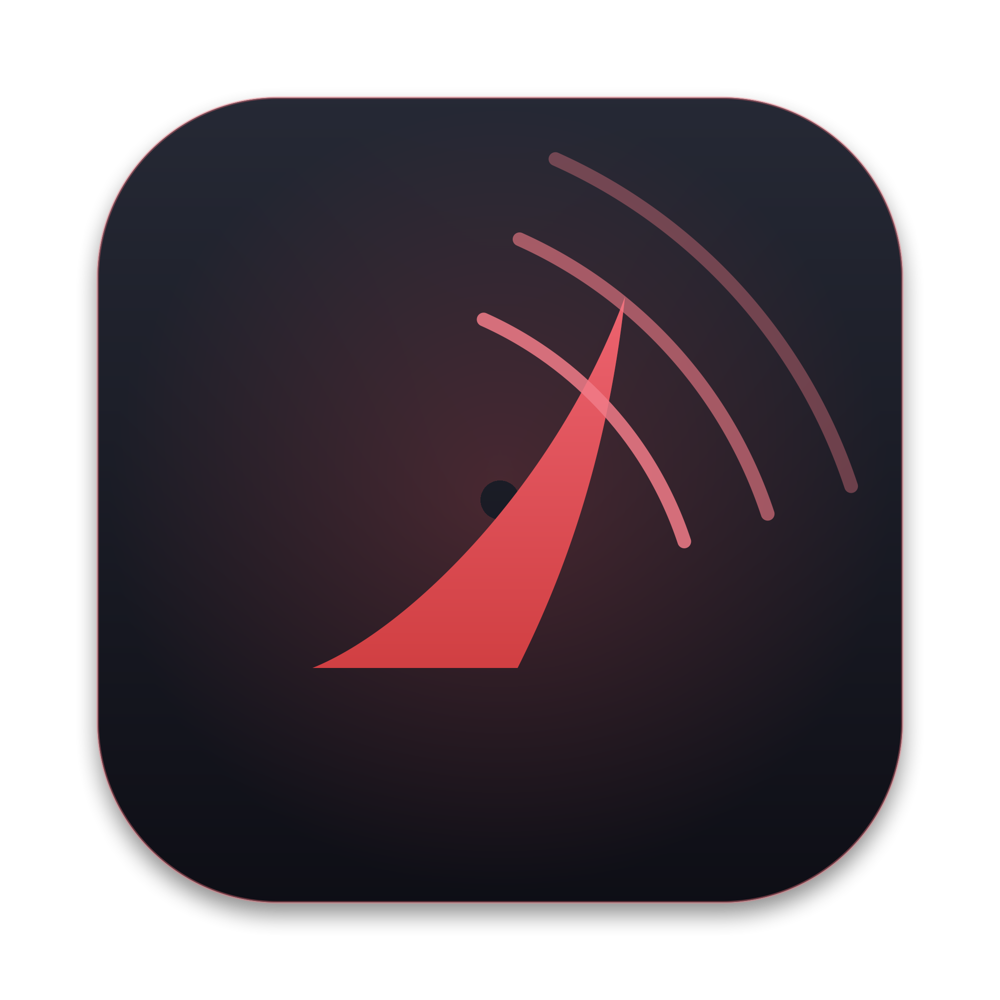
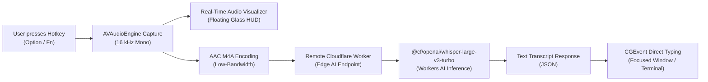

# Orca Whisper

<div align="center">
  
  <h3>Ultra-Lightweight Native macOS Voice Dictation</h3>
  <p>Hold or tap a global key, speak naturally, and watch text appear instantly in any focused application.</p>
</div>

---

## Highlights

- **Pure Native Swift & SwiftUI**: Crafted exclusively with Apple's native APIs (`AVFoundation`, `AppKit`, `CoreGraphics`, `Security`, `ServiceManagement`). Zero Electron, zero Python, zero web views.
- **Zero Local Model Footprint**: Runs zero local AI models. Idle CPU is 0.0%, and memory usage is negligible.
- **Remote Cloudflare Workers AI**: Powered by `@cf/openai/whisper-large-v3-turbo` running at the edge on Cloudflare Workers.
- **Direct Unicode Typing**: Injects text directly into your active cursor without touching, clearing, or polluting your macOS clipboard.
- **Fluid Floating HUD**: Features an Apple-inspired liquid glassmorphic HUD that dynamically reacts to your speech volume in real time with animated waveform bars.
- **Flexible Hotkeys**: Trigger dictation with **Right Option**, **Left Option**, **Option (Either)**, **Function (Fn / Globe)**, **Command**, **Control**, or **Shift**.
- **Dual Activation Modes**: Supports both push-to-talk (hold to speak, release to send) and hands-free latching (quick double-tap to lock recording, tap to finish).
- **Privacy First**: Audio is encoded to compressed AAC, streamed to your own private Cloudflare Worker, and destroyed immediately. Credentials stay encrypted in macOS Keychain.

---

## Architecture



---

## Requirements

- macOS 14.0 (Sonoma) or newer
- Apple Silicon Mac (M1/M2/M3/M4)
- A free [Cloudflare](https://dash.cloudflare.com/) account for remote transcription

---

## Quickstart Guide

### 1. Deploy Your Cloudflare Worker

Orca Whisper requires your own private Cloudflare Worker backend. Deployment takes less than 2 minutes using Cloudflare's free tier:

```bash
# Navigate to worker directory
cd worker

# Install dependencies
npm install

# Log in to Cloudflare
npx wrangler login

# Deploy the worker to your Cloudflare account
npx wrangler deploy
```

Note your deployment URL (e.g. `https://orca-whisper-worker.<your-subdomain>.workers.dev`).

Next, generate a secret auth token and set it in your worker secrets:

```bash
# Generate a secure 32-byte token
openssl rand -hex 32

# Set the secret token on your worker
npx wrangler secret put AUTH_TOKEN
```
When prompted, paste your generated token.

---

### 2. Build and Launch the macOS App

From the repository root:

```bash
# Compile and build the release app bundle
./build_app.sh

# Launch Orca Whisper
open OrcaWhisper.app
```

The app will appear as a sleek orca fin icon in your macOS menu bar.

---

### 3. Configure Credentials

1. Open **Orca Whisper** from the menu bar or click **Open Orca Whisper…**.
2. Navigate to **Transcription** in the sidebar.
3. Enter your **Endpoint URL** (`https://<your-worker>.workers.dev`) and **Bearer Token**.
4. Go to **Overview** and click **Test Worker Connection** to confirm connectivity.

---

### 4. Enable macOS Accessibility Permission

macOS requires one-time Accessibility permission so the app can detect your global hotkey and insert transcribed text:

1. Open **macOS System Settings > Privacy & Security > Accessibility**.
2. Toggle the switch next to **OrcaWhisper** to **ON**.

---

## How to Dictate

| Action | Gesture |
| :--- | :--- |
| **Push-to-Talk (Hold)** | Press and hold your trigger key (**Right Option** by default). Speak, then release the key. Your text is typed directly into the active field. |
| **Hands-Free Latch** | Tap the trigger key twice quickly. The HUD indicates *Listening (Hands-Free)*. Speak, then tap the key once to finish. |
| **Cancel Dictation** | Press `Escape` at any point during recording to discard the audio without sending it. |

---

## Configuration Reference

Orca Whisper includes a full native settings interface divided into dedicated tabs:

- **Overview**: Live status indicator, manual test recording button, last transcript preview, latency metrics breakdown, and worker connection test.
- **Hotkey**: Select trigger keys (Option, Fn/Globe, Command, Control, Shift), customize hold/tap thresholds (ms), and set recording time caps.
- **Recording**: Select audio input hardware, adjust AAC bitrates (16–64 kbps), and toggle audio cues.
- **Transcription**: Manage endpoint URL, Keychain-secured token, request timeouts, retry policies, and payload format.
- **Output**: Choose between **Direct Unicode Typing** (zero clipboard impact) or **Clipboard Paste (Cmd+V)** with automatic clipboard restoration, trailing spaces, and prefix/suffix formatting.
- **Appearance**: Toggle the liquid floating HUD, customize menu bar icon styling, and status menu previews.
- **Privacy & Security**: View privacy guarantees, purge stored Keychain tokens, and check system permission statuses.

---

## Security & Privacy

- **No Third-Party Telemetry**: Orca Whisper sends zero analytics or telemetry to anyone.
- **Self-Hosted Inference**: You control your data; audio is routed exclusively to your private Cloudflare Worker and never touches third-party SaaS servers.
- **Temporary Storage**: Audio recordings are written as temporary files in the app's cache sandbox and deleted immediately after upload completes or fails.
- **Encrypted Secrets**: Your Bearer authentication tokens are encrypted using Apple's native `Security` framework in macOS Keychain.

---

## Contributing

Contributions are welcome! Please open an issue or submit a pull request for bug fixes, performance optimizations, or UI polish.

```bash
git clone https://github.com/krish-dmg/orca-whisper.git
cd orca-whisper
swift build
```

---

## License

Orca Whisper is released under the [MIT License](LICENSE).
